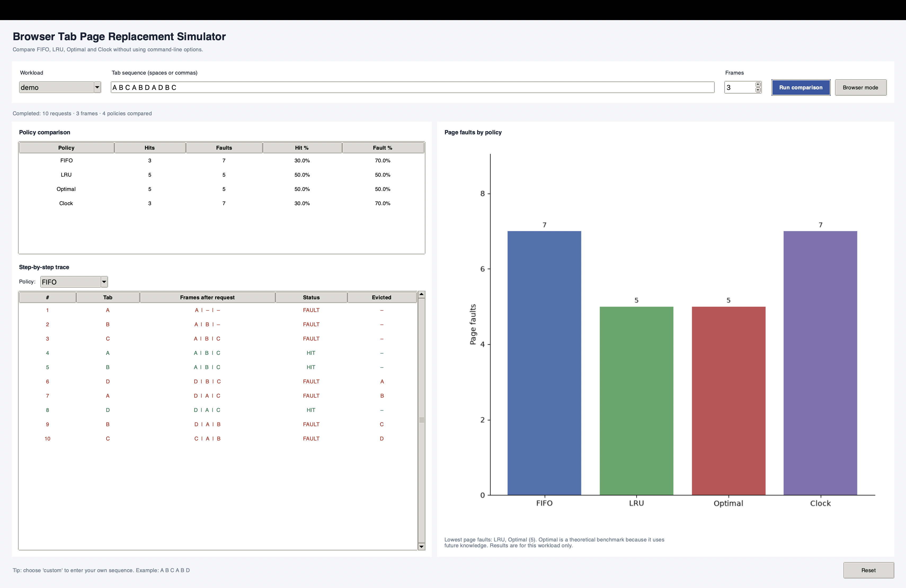
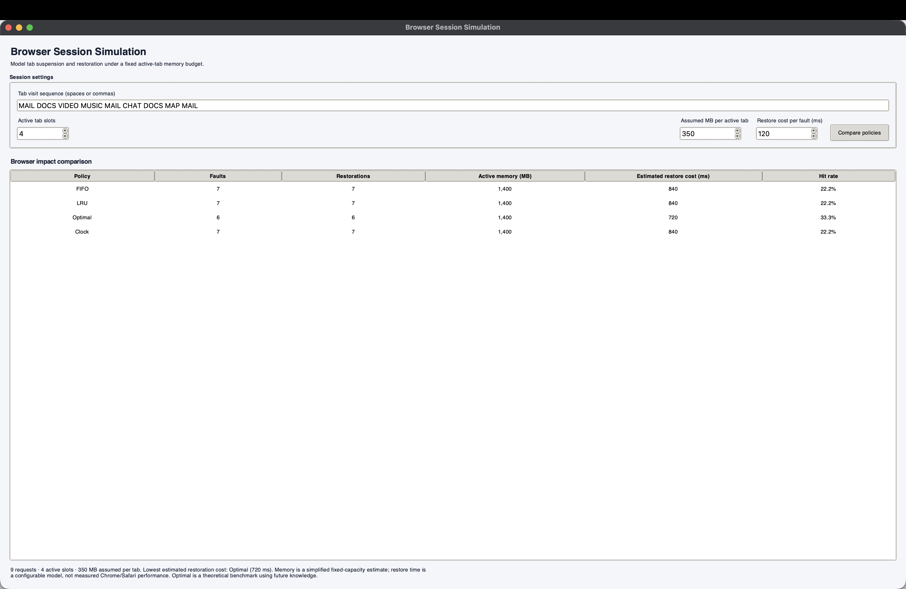

# Browser Tab Page Replacement Simulator

A Python-based desktop application that simulates operating-system page replacement algorithms using browser-tab access patterns. It compares FIFO, LRU, Optimal, and Clock through a graphical interface, step-by-step traces, and performance summaries.

## Features

- **Four replacement algorithms:** FIFO, Least Recently Used (LRU), Optimal, and Clock.
- **Custom workloads:** Enter tab access sequences using spaces or commas.
- **Preset workloads:** Explore demo, textbook, revisit, random, cyclic, and Belady's anomaly sequences.
- **Policy comparison:** Compare page hits, page faults, hit ratios, and fault ratios.
- **Step-by-step trace:** Inspect frame contents, hits, faults, and evicted tabs after each request.
- **Visualisation:** Compare page faults across replacement algorithms.
- **Browser Session Mode:** Configure a simulated tab sequence, active-tab capacity, assumed memory per tab, and restoration cost.
- **Automated tests:** Validate the replacement-policy implementation.

## Screenshots

### Main Simulator


### Browser Session Mode


## Technologies

- Python
- Tkinter for the desktop GUI
- Matplotlib for charts
- pytest for automated testing

## Requirements

- Python 3
- Dependencies listed in `requirements.txt`

## Installation

Clone the repository and enter the project directory:

```bash
git clone https://github.com/meher0204/tab-replacement-simulator.git
cd tab-replacement-simulator
```

Create and activate a virtual environment:

```bash
python3 -m venv .venv
source .venv/bin/activate
```

Install dependencies:

```bash
python3 -m pip install -r requirements.txt
python3 -m pip install pytest
```

## Run the Application

Launch the main simulator:

```bash
python3 gui.py
```

Choose a preset workload or enter a custom sequence, select the number of frames, and run the comparison.

Open **Browser mode** to explore the browser-session simulation with configurable inputs.

## Run Tests

```bash
python3 -m pytest -q
```

## How It Works

Each tab request is checked against the active frames.

- **Hit:** The requested tab is already in memory.
- **Fault:** The requested tab is not in memory and must be loaded.
- **Eviction:** When all frames are occupied, the selected replacement policy chooses a tab to remove.

### Replacement Policies

| Algorithm | Replacement strategy |
|---|---|
| FIFO | Evicts the tab loaded earliest. |
| LRU | Evicts the tab least recently used. |
| Optimal | Evicts the tab whose next use is farthest in the future, or which is never used again. |
| Clock | Uses reference bits and a circular pointer to provide second chances. |

Optimal is included as a theoretical benchmark because it requires knowledge of future requests.

## Browser Session Simulation

Browser Session Mode reuses the replacement-policy engine to model a browser workload under a limited number of active tab slots.

It displays page faults, estimated restoration cost, and a simplified active-memory estimate. These values are illustrative model outputs, not measurements taken from Chrome, Safari, or another real browser.

## Limitations

- Browser tab behavior is simulated; the application does not connect to a live browser.
- Memory usage is estimated using a configurable fixed amount per active tab.
- Restoration cost is calculated from the number of faults and the configured cost per fault.
- Optimal uses future knowledge and is not a practical online replacement strategy.

## Project Structure

```text
tab-replacement-simulator/
├── gui.py
├── main.py
├── requirements.txt
├── tabsim/
│   ├── policies.py
│   ├── simulator.py
│   ├── workloads.py
│   ├── reporter.py
│   └── browser_mode.py
├── tests/
│   └── test_policies.py
├── screenshots/
└── README.md
```

## Author

**Meher Gandhok**

GitHub: [meher0204](https://github.com/meher0204)
